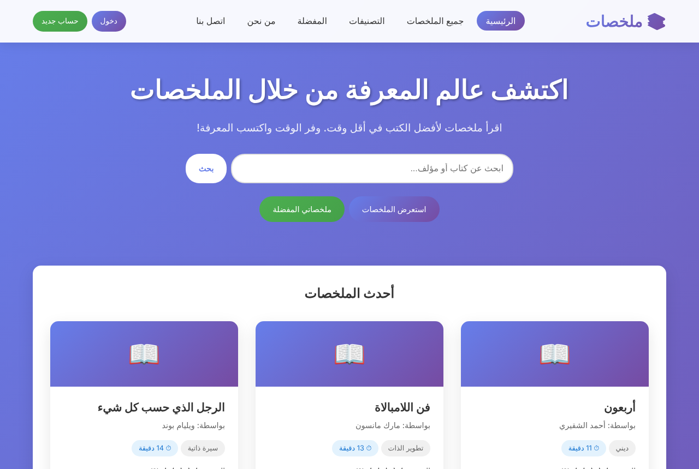
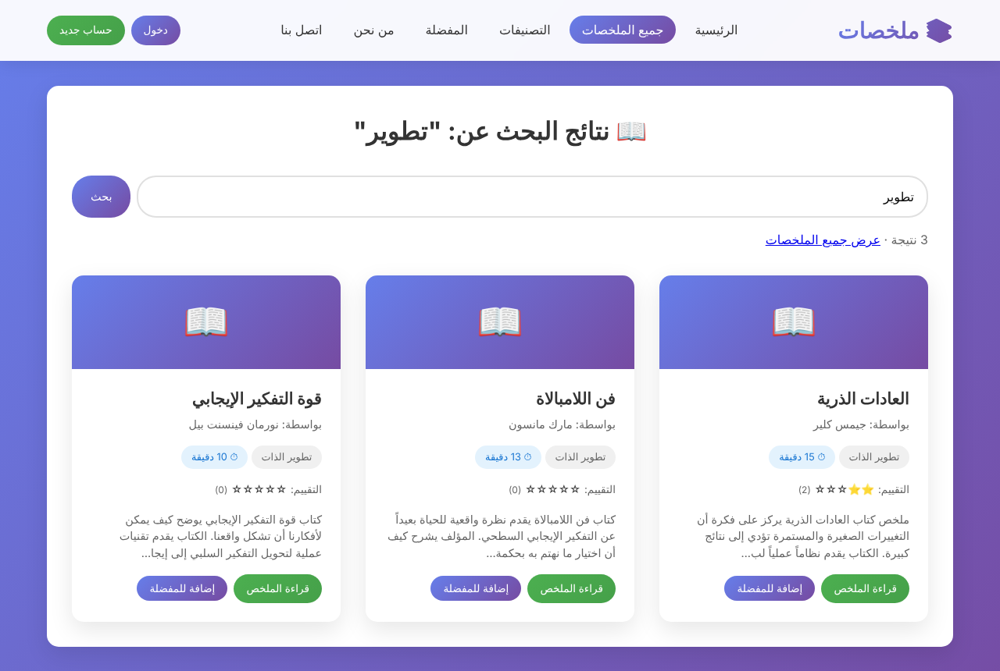
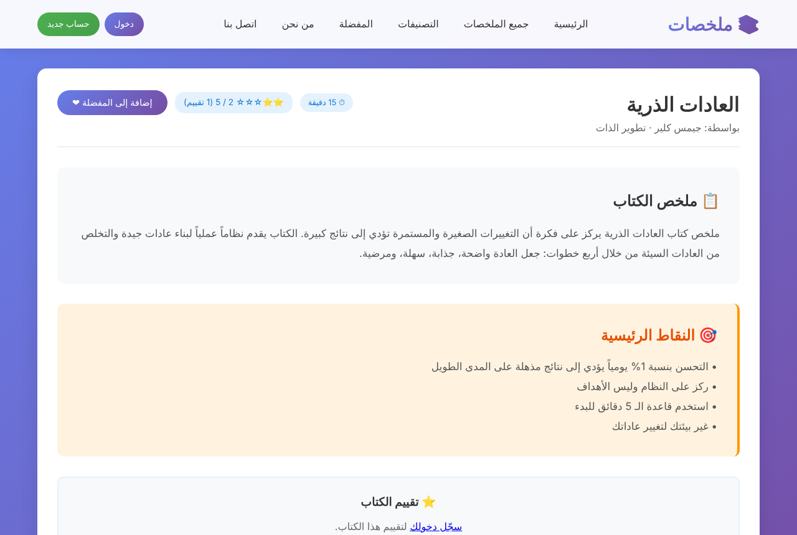

# 📚 Molakhasat — Arabic Book Summaries Platform

> منصة عربية لملخصات الكتب: ابحث، اقرأ الملخص في دقائق، احفظ مفضلتك ورتّبها، وقيّم الكتب.

A full-stack web application for reading short Arabic summaries of popular books.
Users can create an account, search the library, save favorites in their own custom order,
and rate books from 1 to 5 stars. The interface is fully right-to-left (RTL) Arabic.



## ✨ Features

| Feature | Details |
|---|---|
| 🔐 **User accounts** | Register, log in and log out. Passwords are hashed with `password_hash()` (bcrypt). |
| 🔎 **Search** | Server-side search by title, author or category, combined with category filters. |
| ❤ **Personal favorites** | Each user has their own favorites list, reordered with drag & drop (saved via AJAX). |
| ⭐ **Ratings** | One rating per user per book (can be changed later); the average updates instantly. |
| 📂 **Categories** | Browse by category, with live counts from the database. |
| ✉ **Contact form** | Validated form; messages are stored in the database. |
| 📱 **Responsive** | Works on desktop and mobile. |

## 🛡 Security

Security was a focus of this project:

- **SQL injection** — every query uses PDO prepared statements; LIKE wildcards are escaped in search.
- **XSS** — all output is escaped with a single `e()` helper (`htmlspecialchars`).
- **CSRF** — every form and the AJAX endpoint require a per-session token. Actions that change data (favorites, ratings, logout) only accept `POST`.
- **Authorization** — favorites and ratings are always filtered by the logged-in `user_id`, so one user can't read or change another user's data.
- **Sessions** — `HttpOnly` + `SameSite` cookies; session ID regenerated at login (prevents session fixation).
- **Open redirects** — return URLs are validated to stay inside the site.
- **No secrets in code** — database credentials come from environment variables.

## 🧰 Tech Stack

- **Backend:** PHP 8 (PDO)
- **Database:** MySQL / MariaDB (SQLite also supported for a quick demo)
- **Frontend:** HTML5, CSS3, vanilla JavaScript, [SortableJS](https://sortablejs.github.io/Sortable/) for drag & drop

## 🗂 Project Structure

```
├── index.php, summaries.php, summary.php, ...   # Pages
├── login.php, register.php, logout.php          # Authentication
├── add_favorite.php, remove_favorite.php,
│   add_rating.php, update_favorite_order.php    # Actions (POST only)
├── includes/
│   ├── bootstrap.php     # Session, DB connection, helpers (escaping, CSRF, auth)
│   ├── header.php        # Shared header + navigation
│   ├── footer.php        # Shared footer
│   ├── book_card.php     # Reusable book card component
│   └── favorite_button.php
├── assets/css/style.css
├── assets/js/script.js
├── database/
│   ├── schema.mysql.sql  # MySQL tables
│   ├── schema.sqlite.sql # SQLite tables
│   └── seed_books.php    # Sample summaries
├── tests/e2e.sh          # End-to-end tests
├── config.php            # Reads DB settings from environment variables
└── setup.php             # One-click installer
```

### Database

```
users ──< favorites >── books
users ──< ratings   >── books
contact_messages
```

`favorites` and `ratings` each have a unique `(user_id, book_id)` key, so a user can't save or rate the same book twice.

## 🚀 Run It Locally

### Option 1 — XAMPP / MAMP (MySQL)

1. Copy the project folder into `htdocs/`.
2. Start **Apache** and **MySQL** from the XAMPP control panel.
3. Open `http://localhost/web-project/setup.php` — it creates the database, the tables and sample summaries.
4. Open `http://localhost/web-project/` and create an account.

Default connection: `localhost`, user `root`, empty password, database `booksummaries`.
To change it, set the environment variables `DB_HOST`, `DB_NAME`, `DB_USER`, `DB_PASS`.

### Option 2 — Quick demo with SQLite (no MySQL needed)

```bash
DB_DRIVER=sqlite php -S localhost:8000
# then open http://localhost:8000/setup.php, then http://localhost:8000
```

> **Upgrading from the first version?** The database structure changed (users were added),
> so delete the old `booksummaries` database in phpMyAdmin, then open `setup.php` again.
>
> Delete `setup.php` before deploying the site to a public server.

### Run the tests

```bash
bash tests/e2e.sh
```

33 end-to-end checks run against a temporary SQLite database: registration, login, search,
favorites, ratings, reordering, and security checks (XSS, CSRF, open redirects, users not
being able to change each other's data).

## 📸 Screenshots

| Search | Book summary |
|---|---|
|  |  |


## 🛣 Ideas for Next Steps

- Admin dashboard to add and edit summaries
- Book cover images
- Login rate limiting and password reset by email

## 👩‍💻 Author

**Nora Abdulaziz** — Computer Science student, Prince Sattam bin Abdulaziz University
GitHub: [@nora2164](https://github.com/nora2164)
